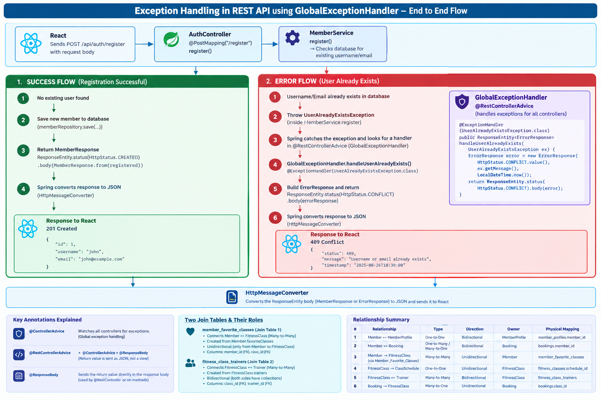

Let's go one piece at a time with simple analogies.

## `ResponseEntity<>` — think of it as an envelope

Normally, if a method just returns an object, Spring only lets you control *what's inside* the response — not the "outside" details like the status code.

`ResponseEntity` is Spring's way of saying: **"don't just hand me the letter, hand me the whole envelope"** — the letter (your data) *plus* things like:
- the status code (200 OK? 201 Created? 404 Not Found?)
- extra headers, if you need any

Without `ResponseEntity`, every single response just quietly says "200 OK" no matter what actually happened. `ResponseEntity` lets you say "no, actually, THIS specific response should say 201" or "401" etc.

## The `<MemberResponse>` part — what's going inside the envelope

```java
ResponseEntity<MemberResponse>
```

This is just saying: "the letter inside this envelope will be a `MemberResponse`." It's like labeling a box "Fragile — Glass Inside" before you even pack it — you're telling everyone in advance what type of thing they'll find when they open it.

## `ErrorResponse` — a "standard error letter" your app always uses

Look at your `ErrorResponse` class:
```java
public class ErrorResponse {
    private final int status;
    private final String message;
    private final Map<String, String> fieldErrors;
    private final LocalDateTime timestamp;
}
```

Whenever something goes wrong (wrong password, class is full, etc.), instead of sending back some random error text, your app ALWAYS sends the same *shape* of error — status number, a message, maybe which form fields were wrong, and when it happened. This makes it predictable for React to read: no matter *what* went wrong, it always knows where to look for the message.

You can see this used in `GlobalExceptionHandler`:
```java
return ResponseEntity.status(HttpStatus.CONFLICT).body(new ErrorResponse(...));
```
Same idea as before — envelope (`ResponseEntity`) with a status code, containing a standard error letter (`ErrorResponse`) inside.

## Now let's walk through your actual line, piece by piece:

```java
return ResponseEntity.status(HttpStatus.CREATED).body(MemberResponse.from(registered));
```

**Step 1 — `ResponseEntity.status(HttpStatus.CREATED)`**
This is choosing the envelope's stamp: "Mark this response as `201 Created`." That's the correct status for "you asked me to make something new, and I successfully made it" — which is exactly what registering a new member is.

**Step 2 — `.body(...)`**
This is saying "and here's what goes INSIDE the envelope."

**Step 3 — `MemberResponse.from(registered)`**
`registered` is the actual `Member` object that just got saved to the database (it has the username, email, **and password** on it). But you don't want to send the password back to React! So `MemberResponse.from(registered)` copies over ONLY the safe fields (id, username, email, registeredOn) into a brand-new, smaller object — leaving the password behind completely, since `MemberResponse` doesn't even have a field for it.

**Putting the whole sentence together in plain English:**

> "Send back a response that says '201, I created it', and inside, include only the safe member info (never the password)."

    **What actually reaches the React app** (as real JSON) looks like:
    ```json
                {
                  "id": 5,
                  "username": "ravi_k",
                  "email": "ravi@example.com",
                  "registeredOn": "2026-09-10T14:22:00"
                }
        ```
No password anywhere in sight — not because you filtered it out at the last second, but because you built a brand-new "safe" object that never had a spot for it in the first place.

--------------------------------------------------------------------------------------------------------------------

@RestControllerAdvice 

@ControllerAdvice — in plain words

Normally, if a controller method throws an exception and nobody catches it, Spring just sends back an ugly generic error page/response. @ControllerAdvice is Spring's way of saying:

"Hey Spring — watch EVERY controller in this whole app. If ANY of them throws an exception, come check this class first before giving up."

It's like having one single "customer complaints desk" for an entire building, instead of every single office having to handle its own complaints separately. You write the handling logic once, in GlobalExceptionHandler, and it applies everywhere — you never repeat try/catch blocks in AuthController, ClassController, BookingController, etc.

@ResponseBody — in plain words

This one just says: "whatever this method returns, don't treat it as a page name — send it directly as the actual response content (in our case, JSON)."

You've actually already learned this exact idea earlier — it's the same mechanism behind @RestController (@RestController = @Controller + @ResponseBody on every method).

Putting them together: @RestControllerAdvice

Your GlobalExceptionHandler uses @RestControllerAdvice, which is simply:

@RestControllerAdvice = @ControllerAdvice + @ResponseBody

In plain words: "Watch every controller for exceptions (@ControllerAdvice), and whatever I return from my handler methods, send it as raw JSON, not a page (@ResponseBody)."

 


