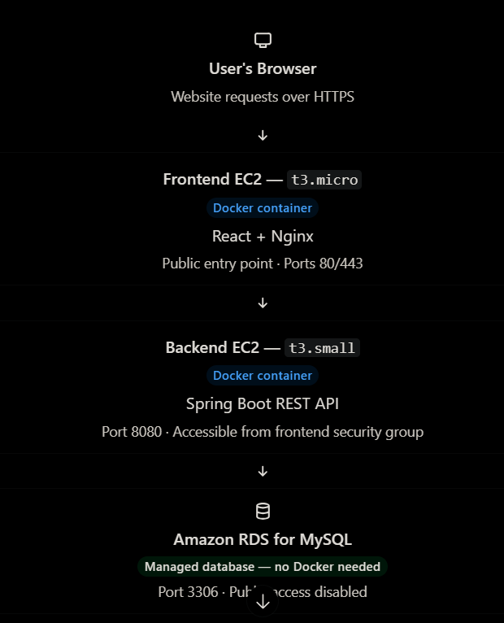

Yes, let's clarify the architecture before we proceed. Your plan is to run Docker containers on your two EC2 instances, while using AWS RDS for the database.

One important correction: You should not run MySQL inside a Docker container on RDS. Amazon RDS is already a managed database service. AWS manages the MySQL server for you, so you don't install Docker or run your own MySQL container there.

## Your FitClub production architecture



## What runs where?

| Resource     | What runs inside it?                               |
| ------------ | -------------------------------------------------- |
| Frontend EC2 | Docker Engine and frontend/Nginx container         |
| Backend EC2  | Docker Engine and Spring Boot container            |
| Amazon RDS   | AWS-managed MySQL database, not your own container |

## What happens to your `.env` file?

Your backend container needs the database connection variables:

```
DB_HOST=<your-rds-mysql-endpoint>
DB_PORT=3306
DB_NAME=Spring14FitClub
DB_USERNAME=<your-database-username>
DB_PASSWORD=<your-database-password>
```

When starting the backend container, Docker must receive these variables. For example, `docker run --env-file .env ...` loads them from a file on the EC2 host. For production, AWS Secrets Manager or Systems Manager Parameter Store is preferable for managing credentials securely.

Also, ensure that the RDS endpoint you use belongs to your MySQL instance. Your earlier screenshot showing PostgreSQL port `5432` was a different configuration; your MySQL database should use port `3306`.

## Our next step

Let's proceed in this order:

1. Verify your backend `application.properties` uses the environment variables above.
2. Create or verify the backend Dockerfile.
3. Build and push the backend image to Docker Hub.
4. Run the backend container on the backend EC2 and test its RDS connection.
5. Dockerize the React frontend with Nginx reverse proxying `/api/` to the backend's private address.
6. Test the complete application.

First, tell me: Have you already created a `Dockerfile` for your Spring Boot backend, or should we create it now?