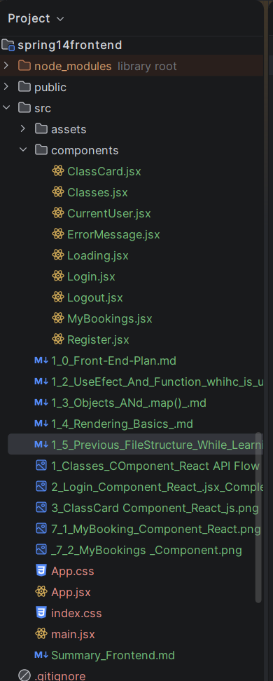

What changes made in file structure 

WHy changed The previous Structure 





code : 

```
import heroImg from './assets/hero.png'
import reactLogo from './assets/react.svg'
import viteLogo from './assets/vite.svg'

import Classes from "./components/Classes.jsx";
import Login from "./components/Login";
import { useState, useEffect } from "react";
import './App.css';
import CurrentUser from "./components/CurrentUser.jsx";
import Logout from "./components/Logout.jsx";
import Register from "./components/register.jsx";
import MyBookings from "./components/MyBookings.jsx";

function App() {

/*      This part of logic is shifted to "Classes.jsx" component  before creating that component this logic existed here...
//It was written here to understand UseState() hook ....
    const[classes, setClasses] = useState([
        {
            id: 1,
            className: "Morning Yoga",
            description: "Gentle flow to start your day",
            capacity: 20,
            confirmedBookingCount: 12
        },
        {
            id: 2,
            className: "Strength Training",
            description: "Build strength and improve fitness",
            capacity: 15,
            confirmedBookingCount: 8
        }
    ]) ;
*/

    ////  In "Classes.jsx" component this logic is implemented using "getClasses()" function ... earlier it was here in App.jsx before creating Classes Component
  //Reason: Written here to understand UseEffect() hook ...
   /* using : UseEffect*/
  /*  useEffect(() => {
        console.log("App component loaded");
        fetch("http://localhost:8080/api/classes")
            .then((response) =>
                {
                    if (!response.ok) {
                        throw new Error(`HTTP error: ${response.status}`);
                    }

                    return response.json();
                })
            .then( (data)=>
            {
                console.log("JSON data:",data);
            })
    }, []);
*/


  /*  // TEMPORARY PRACTICE DATA — shaped from GET /api/classes
  //Reason: Written data to understand how the flow of data is In React ...
    const classes = [
        {
            id: 1,
            className: "Morning Yoga",
            description: "Gentle flow to start your day",
            capacity: 20,
            confirmedBookingCount: 12
        },
        {
            id: 2,
            className: "Strength Training",
            description: "Build strength and improve fitness",
            capacity: 15,
            confirmedBookingCount: 8
        }
    ];
    */
    const [loginVersion, setLoginVersion] = useState(0);


    return (
        <div>
            <h1>FitClub</h1>

            <Login onLoginSuccess={() => setLoginVersion(v =>v+1)} />

            <CurrentUser/>

            <Classes/>

            <Logout/>

            <Register/>

            <MyBookings loginVersion={loginVersion} />

        </div>
    );
    /*Inside return statement we manually added 2 values it was just to learn the flow of programme and learn what are props and how data is displayed */
    /*
            <ClassCard
                className="Morning Yoga"
                description="Gentle flow to start your day"
                capacity={20}
                confirmedBookingCount={12}
            />

            <ClassCard
                className="Strength Training"
                description="Build strength and improve fitness"
                capacity={15}
                confirmedBookingCount={8}
            />
        </div>
    * */


    //This below logic was written inside the return statement to understand how the data is mapped and displayed in frontend... with the help of an component...
    /*   This part of logic is shifted to "Classes.jsx" component  before creating that component this logic existed here...
          {classes.map((fitnessClass) => {
              return (
                  <ClassCard
                      key={fitnessClass.id}
                      className={fitnessClass.className}
                      description={fitnessClass.description}
                      capacity={fitnessClass.capacity}
                      confirmedBookingCount={fitnessClass.confirmedBookingCount}
                  />);
          })} */
}


export default App;

```