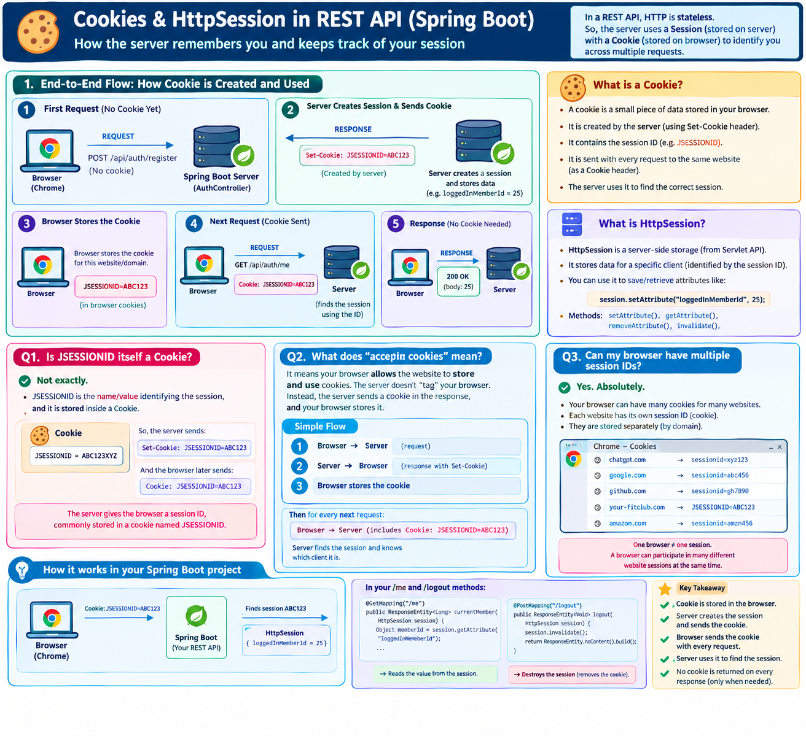

# Servelet → Session

Yes. Since you have **not studied Servlets yet**, the confusing part is that `HttpSession` comes from the **Servlet/HTTP layer**, not from JPA or Spring Data JPA.

I’ll build the concept from zero and then connect it directly to your two methods.

---

# Q1. What does `Session` mean?

First forget Spring Boot for a moment.

Imagine you log into your application:

```
Email: abc@gmail.com
Password: ******
        ↓
Login successful
```

The server needs to remember:

> "This browser has logged in as Member ID = 25."
> 

But HTTP itself is **stateless**.

### Stateless means:

Every HTTP request is treated independently.

```
Request 1 → Server
           "Login with abc@gmail.com"

Request 2 → Server
           "GET /me"

Request 3 → Server
           "GET /orders"

Request 4 → Server
           "POST /logout"
```

The server does not automatically know that:

```
Request 2
```

came from the same person who made:

```
Request 1
```

This is where a **session** comes in.

---

# 1. What is a Session?

A **session is server-side storage associated with one client/browser session**.

Think of it as a small box maintained by the server:

```
             SERVER

       ┌─────────────────────┐
       │     HTTP SESSION    │
       │                     │
       │ loggedInMemberId=25 │
       │                     │
       └─────────────────────┘
```

The server can store information inside this box.

For example:

```
loggedInMemberId → 25
```

Then later, when the same client makes another request, the server can find that session and retrieve:

```
25
```

---

# 2. But how does the server know which session belongs to which browser?

This is the **most important part**.

When a session is created, the server gives the client a unique identifier.

Usually this is sent as a cookie:

```
JSESSIONID
```

Conceptually:

```
Browser                         Server
   │                               │
   │  Login request                │
   │ ─────────────────────────────►│
   │                               │
   │                  creates      │
   │                  Session      │
   │                               │
   │◄──── JSESSIONID=ABC123 ──────│
   │                               │
```

The browser stores:

```
JSESSIONID = ABC123
```

Then on the next request:

```
Browser
   │
   │ GET /me
   │
   │ Cookie:
   │ JSESSIONID=ABC123
   ▼
Server
```

The server says:

> "I received session ID `ABC123`. Let me find the session associated with that ID."
> 

It finds:

```
Session ABC123
       │
       └── loggedInMemberId = 25
```

That's how the server remembers the client.

---

Questions on Session and Generated Image to understand it quickly : 



[HTTP basics](https://app.notion.com/p/HTTP-basics-3df5b72e6bf680dc8abae6f97e6d2aa5?pvs=21)

---

`_Servlet_Session_HTTP_Basics_And_WHatAre_Cookies_.md   ---> REfer to this .md file it is in "Spring14" Project`   

---

# 3. What is `HttpSession`?

`HttpSession` is a **Servlet API object representing that server-side session**.

You can think of it as:

```
HttpSession
     │
     ├── getAttribute()
     ├── setAttribute()
     ├── removeAttribute()
     └── invalidate()
```

It allows your application to interact with the session.

For example:

```
session.setAttribute(...)
```

means:

> Put some information into this client's session.
> 

And:

```
session.getAttribute(...)
```

means:

> Get information from this client's session.
> 

And:

```
session.invalidate()
```

means:

> Destroy this session.
> 

---

# 4. Where does `HttpSession` come from?

This is important because you're learning Spring Boot.

```java
HttpSession
```

comes from the **Servlet API**:

```
HTTP
 ↓
Servlet API
 ↓
HttpSession
 ↓
Spring MVC
 ↓
Your Controller
```

In a normal Spring Boot application, an embedded Servlet container such as Tomcat provides the Servlet infrastructure.

So:

```
Spring Boot application
        │
        ▼
Spring MVC
        │
        ▼
Servlet infrastructure
        │
        ▼
HttpSession
```

You don't have to manually create the `HttpSession` object in your controller.

Spring MVC can provide the current request's session to your controller method.

---

# 5. Your controller

You have:

```java
@PostMapping("/logout")
public ResponseEntity<Void> logout(HttpSession session){
    session.invalidate();
    return ResponseEntity.noContent().build();
}
```

Notice:

```java
HttpSession session
```

This is **not JSON data**.

It is an object representing the session associated with the current HTTP request.

The flow is approximately:

```
HTTP Request
     │
     │ Cookie: JSESSIONID=ABC123
     ▼
DispatcherServlet
     │
     ▼
Spring MVC
     │
     │ finds current session
     ▼
HttpSession object
     │
     ▼
AuthController.logout(session)
```

So your controller receives access to the current session.

---

# 6. What is stored inside your session?

Your project uses:

```java
session.getAttribute("loggedInMemeberId");
```

Therefore somewhere during the login process, the application must have something conceptually equivalent to:

```
session
   │
   └── "loggedInMemeberId"
             │
             ▼
             25
```

The important thing is:

### The session stores the value.

Not the browser.

Not the database.

Not JPA.

Not the `Member` object itself.

The session is server-side storage.

---

# 7. Your `/me` method

Now look at this:

```java
@GetMapping("/me")
public ResponseEntity<Long> currentMember(HttpSession session)
{
    Object memberId = session.getAttribute("loggedInMemeberId");

    if(memberId == null){
        return ResponseEntity.status(HttpStatus.UNAUTHORIZED).build();
    }

    return ResponseEntity.ok((Long) memberId);
}
```

Let's follow it **end to end**.

---

## Step 1 — React sends request

Suppose React sends:

```
GET /api/auth/me
```

The browser also sends its session cookie:

```
Cookie: JSESSIONID=ABC123
```

Conceptually:

```
React / Browser
       │
       │ GET /api/auth/me
       │ JSESSIONID=ABC123
       ▼
Spring Boot
```

---

## Step 2 — Spring receives the request

Spring MVC receives the request through the Servlet infrastructure.

```
HTTP Request
      │
      ▼
Servlet Container
      │
      ▼
DispatcherServlet
```

The `JSESSIONID` tells the server which session belongs to this request.

```
JSESSIONID=ABC123
          │
          ▼
Session ABC123
          │
          └── loggedInMemeberId = 25
```

---

# Step 3 — Controller gets `HttpSession`

Spring MVC invokes:

```java
currentMember(HttpSession session)
```

and gives your method access to the current session.

So mentally:

```
currentMember(
      session = Session ABC123
)
```

---

# Step 4 — Your code asks the session for the member ID

You execute:

```java
session.getAttribute("loggedInMemeberId");
```

The session contains:

```
Session ABC123

┌──────────────────────────────┐
│ loggedInMemeberId → 25       │
└──────────────────────────────┘
```

So:

```java
memberId
```

becomes:

```
25
```

---

# Step 5 — If nothing is stored

Suppose the session contains:

```
Session ABC123

┌──────────────────────────────┐
│                              │
│ no loggedInMemeberId         │
└──────────────────────────────┘
```

Then:

```java
session.getAttribute("loggedInMemeberId")
```

returns:

```
null
```

Your code then executes:

```java
return ResponseEntity
        .status(HttpStatus.UNAUTHORIZED)
        .build();
```

So the client gets:

```
HTTP 401 Unauthorized
```

---

# Step 6 — If the member ID exists

Suppose:

```
loggedInMemeberId = 25
```

Then:

```java
return ResponseEntity.ok((Long) memberId);
```

produces:

```
HTTP 200 OK

25
```

Since your method returns:

```java
ResponseEntity<Long>
```

Spring sends that returned value as the HTTP response body.

---

# Complete `/me` flow

```
                    BROWSER / REACT
                          │
                          │ GET /api/auth/me
                          │
                          │ Cookie:
                          │ JSESSIONID=ABC123
                          ▼
                ┌─────────────────────┐
                │ Servlet Container    │
                │     + Spring MVC     │
                └──────────┬──────────┘
                           │
                           ▼
                    Find Session
                       ABC123
                           │
                           ▼
              ┌────────────────────────┐
              │ HttpSession            │
              │                        │
              │ loggedInMemeberId = 25 │
              └───────────┬────────────┘
                          │
                          ▼
               AuthController.currentMember()
                          │
                          ▼
             session.getAttribute(...)
                          │
                          ▼
                         25
                          │
                          ▼
                 ResponseEntity.ok(25)
                          │
                          ▼
                    HTTP 200 OK
                          │
                          ▼
                    React receives
                         25
```

---

# Q2. What exactly does `HttpSession` do in `/logout`?

Your code:

```java
@PostMapping("/logout")
public ResponseEntity<Void> logout(HttpSession session){
    session.invalidate();
    return ResponseEntity.noContent().build();
}
```

The important line is:

```java
session.invalidate();
```

It means:

> **Destroy the current session.**
> 

Before logout:

```
Browser
   │
   │ JSESSIONID=ABC123
   ▼
Server

Session ABC123
┌─────────────────────────────┐
│ loggedInMemeberId = 25      │
└─────────────────────────────┘
```

After:

```java
session.invalidate();
```

the session is destroyed/invalidated.

Conceptually:

```
Session ABC123
       │
       X
       │
   INVALID
```

Therefore the server no longer has that active session containing:

```
loggedInMemeberId = 25
```

Your controller then returns:

```java
ResponseEntity.noContent().build();
```

which means:

```
HTTP 204 No Content
```

---

# What happens if `/me` is called after logout?

This is the important connection between the two methods.

### Before logout

```
Session
   │
   └── loggedInMemeberId = 25
```

Calling:

```
GET /me
```

results in:

```
25
```

---

### Logout

```
POST /logout
       │
       ▼
session.invalidate()
       │
       ▼
Session destroyed
```

---

### Then `/me`

```
GET /me
       │
       ▼
session.getAttribute("loggedInMemeberId")
       │
       ▼
null
       │
       ▼
401 Unauthorized
```

So these two methods are connected:

```
             LOGIN
               │
               │ session stores member ID
               ▼
       ┌───────────────────┐
       │ HttpSession       │
       │                   │
       │ memberId = 25     │
       └─────────┬─────────┘
                 │
          ┌──────┴───────┐
          │              │
          ▼              ▼
       GET /me        POST /logout
          │              │
          │              │
          ▼              ▼
     getAttribute()   invalidate()
          │              │
          ▼              ▼
        25          session destroyed
```

---

# One very important distinction

Don't think:

> `HttpSession` = login
> 

That's not exactly correct.

Instead:

```
HttpSession
      ↓
A server-side place to maintain information
      ↓
Your application chooses what to store there
```

Your application chooses to use it for login state:

```
HttpSession
      │
      └── loggedInMemeberId
```

Another application could store:

```
cartId
language
temporary preferences
```

etc.

So **session is a mechanism; login is one use of that mechanism.**

---

# How this fits into your REST API

Your architecture is roughly:

```
React
  │
  │ HTTP request
  ▼
Spring Boot
  │
  ▼
DispatcherServlet
  │
  ▼
AuthController
  │
  ├── /login
  ├── /me
  └── /logout
       │
       ▼
   HttpSession
       │
       ▼
  Session data
       │
       ▼
  loggedInMemeberId
```

And importantly:

```
HttpSession
      ❌
does NOT replace
      ↓
Service
      ↓
Repository
      ↓
Database
```

For example, `/me` in **your current code** doesn't query the database at all. It simply asks the session:

```
"Who was stored as the logged-in member?"
```

and gets:

```
25
```

---

# Session vs Database

This distinction will save you a lot of confusion later:

|  | HttpSession | Database |
| --- | --- | --- |
| Purpose | Remember information for a client session | Permanently store application data |
| Location | Server-side session storage | Database |
| Example in your project | `loggedInMemeberId = 25` | Member row with `id = 25` |
| Access | `session.getAttribute()` | Repository/JPA query |
| Destroyed by logout? | Yes, your code invalidates it | No |
| JPA involved? | ❌ No | ✅ Yes |
| Servlet concept? | ✅ Yes | ❌ No |

---

## The complete mental model to remember

```
                 HTTP IS STATELESS
                       │
                       ▼
          Server needs a way to remember
          "who is making these requests?"
                       │
                       ▼
                  SESSION
                       │
                       ▼
              HttpSession object
                       │
          ┌────────────┴────────────┐
          │                         │
          ▼                         ▼
   setAttribute()            getAttribute()
   "remember this"            "give it back"
          │                         │
          └────────────┬────────────┘
                       │
                       ▼
               loggedInMemberId
                       │
                       ▼
              JSESSIONID cookie
                       │
                       ▼
                 Browser sends
                 it with requests
```

And logout:

```
POST /logout
      │
      ▼
HttpSession
      │
      ▼
invalidate()
      │
      ▼
Session destroyed
      │
      ▼
Future request has no valid
logged-in session state
      │
      ▼
/me → 401 Unauthorized
```

**The key sentence:**

> **`HttpSession` is a server-side mechanism for remembering data across multiple HTTP requests from the same client; in your project, that mechanism is being used to remember the logged-in member's ID.**
>